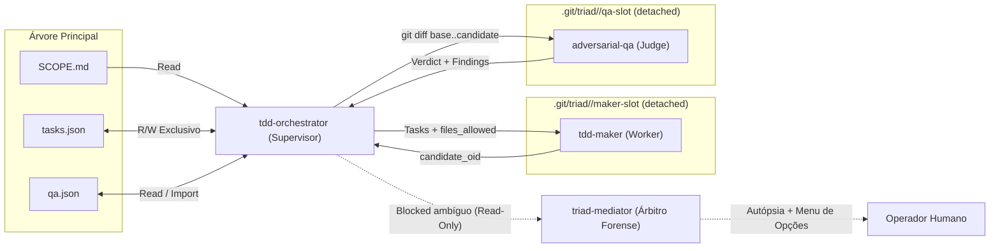
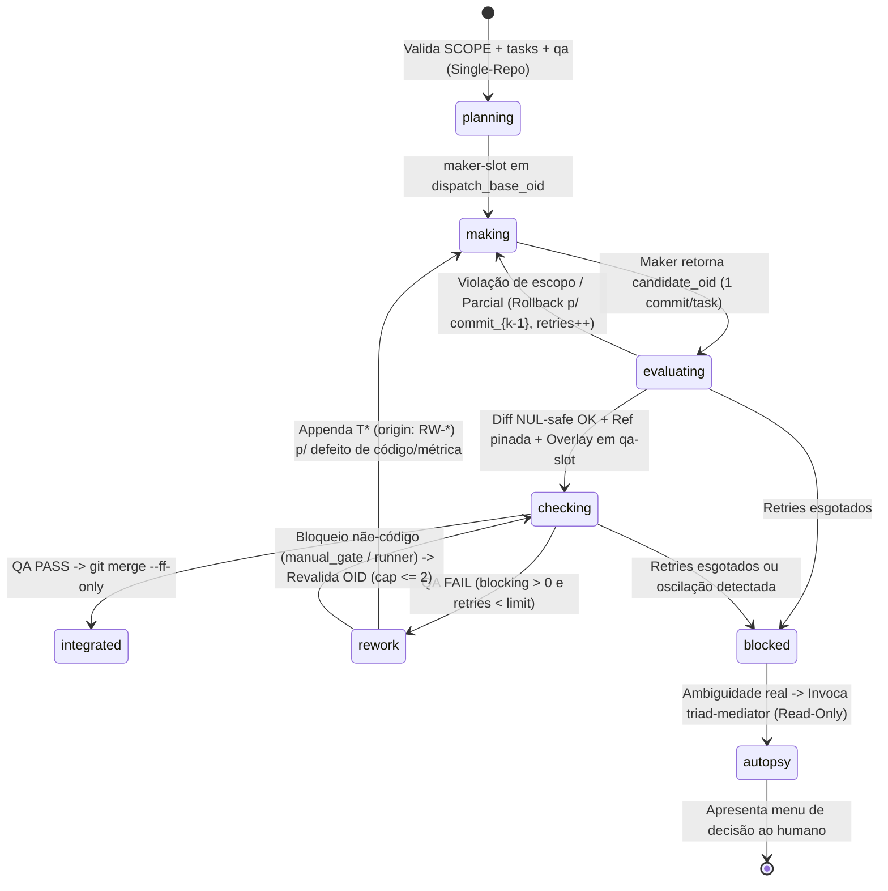

# Blueprint Arquitetural: Tríade Autônoma de TDD (`tdd-orchestrator`)

Especificação portátil para reproduzir a **Tríade Autônoma (`tdd-orchestrator -> tdd-maker -> adversarial-qa`)** com Mediação Forense (`triad-mediator`) em qualquer stack ou framework multiagente.

---

## 1. Problema e Pilares Arquiteturais

Quando um único contexto de LLM lê os requisitos, escreve o teste, implementa o código e audita o resultado, surgem três falhas sistêmicas:
1. **Teaching-to-the-test (Contaminação Cognitiva):** Conhecer os testes destrutivos do juiz (`qa.json`) vicia a implementação para satisfazer apenas os asserts conhecidos.
2. **Scope Creep entre Tasks:** Trabalhar em lote sem confinamento atômico permite que uma task altere arquivos fora de seu escopo.
3. **Corrupção da Árvore Principal:** Candidatos quebrados ou *harnesses* temporários de QA sujam o *working tree* do operador.

### Os 5 Pilares
- **Zero-Knowledge Air-Gap:** `tdd-maker` nunca lê `qa.json` nem herda o histórico do supervisor.
- **Single-Writer State Governance:** Apenas `tdd-orchestrator` grava em `tasks.json` e importa vereditos validados em `qa.json`.
- **Slots Persistentes em `HEAD` Detached:** Construção e QA ocorrem em `<git-common-dir>/triad/<change_id>/{maker-slot,qa-slot}`, trocando *commit OIDs* imutáveis e preservando caches (`node_modules`, `.venv`).
- **Promoção Transacional (`--ff-only`):** A branch alvo só avança via `git merge --ff-only <candidate_oid>` após `PASS` determinístico.
- **Mediação Forense Read-Only (`triad-mediator`):** Bloqueios ambíguos escalam para autópsia independente com diagnóstico diferencial sem poder de mutação.

---

## 2. Topologia de Atores e Matriz de Autoridade



| Recurso | `tdd-orchestrator` | `tdd-maker` | `adversarial-qa` | `triad-mediator` |
|---|---|---|---|---|
| `SCOPE.md` | **Read** (overlay) | **Read** (trecho) | **Read** (overlay) | **Read-Only** |
| `tasks.json` | **R/W Exclusivo** | **Proibido** | **Proibido** | **Read-Only** |
| `qa.json` | **Read / Import** | **PROIBIDO** | **R/W (Overlay)** | **Read-Only** |
| Código de Produção | **Proibido** | **R/W** (`files_allowed`) | **Read-Only** | **Proibido** |
| Harnesses QA | **Arquiva/Restaura** | **Proibido** | **R/W** (`qa-slot`) | **Read-Only** |
| Git Refs e Branches | **Gerencia refs** | **`git commit` detached** | **Proibido** | **Proibido** |

---

## 3. Contratos de Dados (`docs/specs/<change_id>/`)

### 3.1. `SCOPE.md` (Intenção Humana)
Define `In Scope` / `Out of Scope`, fluxo arquitetural, tabela de contratos e critérios de aceite `A1..An` (Gherkin).

### 3.2. `tasks.json` (DAG de Construção + Estado `execution`)
```json
{
  "change_id": "auth-refresh", "scope_hash": "<sha256_de_SCOPE.md>",
  "execution": {
    "target_branch": "main", "accepted_oid": "a1b2c3d", "batch_id": "B1",
    "batch_base_oid": "a1b2c3d", "dispatch_base_oid": "a1b2c3d",
    "task_ids": ["T1"], "candidate_oid": "f9e8d7c",
    "candidate_ref": "refs/triad/candidates/auth-refresh/B1-1",
    "phase": "planning|making|evaluating|checking|rework|integrated|blocked",
    "retry_limit": 2, "retries_used": 0, "qa_reruns_used": 0, "reopens_used": 0
  },
  "tasks": [{
    "id": "T1", "title": "Add sliding TTL refresh",
    "description": "Extend token expiration by 15m on active refresh.",
    "project_path": ".", "tier": "unit | integration",
    "depends_on": [{ "task": "T0", "reason": "consumes TokenPayload from T0" }],
    "contract_delta": { "src/auth.ts": { "refresh(t: string): Promise<Pair>": "added" } },
    "acceptance_ids": ["A1"], "files_allowed": ["src/auth/**", "tests/unit/auth/**"],
    "red": { "test_file": "tests/unit/auth/refresh.spec.ts", "test_ids": ["test_refresh_ttl"] },
    "status": "pending | in_progress | completed | blocked", "origin": "scope | RW-001"
  }]
}
```

### 3.3. `qa.json` (Contrato de Verificação Adversarial)
```json
{
  "change_id": "auth-refresh", "scope_hash": "<sha256_de_SCOPE.md>", "snapshot_ref": "<candidate_oid>",
  "metrics": [{ "name": "coverage", "eval_command": "npm test", "target": ">= 80%", "or": "unavailable: E1" }],
  "invariants": [{
    "id": "QA-I-01", "type": "concurrency | property | e2e | failure_injection | boundary",
    "acceptance_ids": ["A1"], "statement": "Concurrent refresh allows at most 1 success and 401 on replay.",
    "eval_command": "npx vitest run tests/qa/race.spec.ts", "assert_regex": "1 passed",
    "manual_gate": false, "mock_policy": "real | contract-fake", "severity": "blocking | advisory",
    "budget": { "max_wall_clock_s": 180, "max_retries": 2 }
  }],
  "rework_queue": [{
    "id": "RW-001", "invariant_id": "QA-I-01 | SECURITY | BOUNDARY | METRIC:<name>",
    "acceptance_ids": ["A1"], "severity": "blocking | advisory",
    "file": "src/auth.ts:42 | qa.json:QA-I-01",
    "reproducer": "npx vitest run tests/qa/race.spec.ts | manual_gate:QA-I-01",
    "finding": "Concurrent calls bypass non-atomic GET/SET.", "status": "open | resolved"
  }],
  "verdicts": [{ "run_id": 1, "snapshot_ref": "<candidate_oid>", "status": "PASS | FAIL", "blocking_failures": 1, "advisory_findings": 0 }]
}
```

---

## 4. Topologia Física de Slots Git e Refs

Os worktrees residem em `<git-common-dir>/triad/<change_id>/` (`git rev-parse --path-format=absolute --git-common-dir`), fora da árvore rastreada:
- `maker-slot/`: worktree *detached* exclusivo do `tdd-maker`.
- `qa-slot/`: worktree *detached* exclusivo do `adversarial-qa`.
- `qa-harnesses/`: arquivo persistente dos reproducers gerados pelo QA entre tentativas.

```bash
git worktree add --detach "<git-common-dir>/triad/<change_id>/maker-slot" <accepted_oid>
git worktree add --detach "<git-common-dir>/triad/<change_id>/qa-slot" <accepted_oid>
git update-ref refs/triad/candidates/<change_id>/<batch_id>-<attempt> <candidate_oid>
```
*Higienização:* Nunca usar `git clean -fdx` cego (preservar caches ignorados). Remover apenas artefatos/overlays registrados pela rodada antes de `git switch --detach <oid>`.

---

## 5. Máquina de Estados e Protocolo Operacional



1. **Validação Inicial (`planning`):** Rejeita specs multi-repo ou com `scope_hash` divergente. Exige árvore limpa. Congela `retry_limit` (`budget.max_retries`, default `2`).
2. **Construção Cega (`making`):** `tdd-maker` executa **RED -> GREEN -> REFACTOR** estrito por task na ordem topológica, usando `git add -- <explicit_paths>` e gerando **1 commit por task** em `HEAD` *detached*.
3. **Auditoria de Blast-Radius e Rollback Parcial (`evaluating`):**
   - Inspeciona cada commit com `git diff-tree --no-commit-id --name-status -r -z --no-renames <commit>` contra o `files_allowed` da sua task, e o acumulado com `git diff --name-status -z --no-renames <batch_base_oid> <candidate_oid>`.
   - **Rollback para o Último Ancestral Válido:** Se o commit $k$ violar `files_allowed` ou parar na task $k$, preserva os commits $1 \dots k-1$, reseta `maker-slot` para `commit_{k-1}`, atualiza `dispatch_base_oid = commit_{k-1}`, cobra 1 retry e redespacha apenas de $k$ em diante.
4. **Handoff e Overlay de QA (`checking`):**
   - Faz checkout de `qa-slot` em `candidate_oid` e injeta `SCOPE.md`, `qa.json` e os harnesses de `qa-harnesses/` como *controlled overlays* (sem comitá-los).
   - Despacha `adversarial-qa` sobre `git diff <batch_base_oid> <candidate_oid>`.
   - O QA reexecuta todos os itens anteriores de `rework_queue` (`open` **e** `resolved`, reabrindo se regredirem), avalia todas as `metrics` e `invariants` com `mock_policy: "real | contract-fake"` e sonda vulnerabilidades.
   - **Regra Determinística de PASS:** Todas as métricas atingiram `target` (ou possuem fallback `or` autorizado) **E** todas as invariantes passaram dentro do budget (ou possuem aceite em `manual_gate: true`) **E** `count(open + blocking) == 0`.
   - O supervisor valida `HEAD == candidate_oid`, importa `snapshot_ref`, `verdicts` e `rework_queue` para o `qa.json` canônico, e arquiva harnesses novos/atualizados em `qa-harnesses/` antes de limpar o slot.
5. **Rework Seletivo e Freios Anti-Loop (`rework`):**
   - Para findings `RW-*` de código/métrica: cria task `T*` (`origin: "RW-*"`) e redespacha o Maker sobre o `candidate_oid` anterior.
   - Para bloqueios não-código (`manual_gate` sem aceite ou falha externa do runner): solicita aceite ao operador ou reexecuta o QA no mesmo `candidate_oid`, com teto `qa_reruns_used <= 2`.
   - **Freio de Oscilação:** Se o mesmo `RW-*` alternar `resolved -> open` $\ge 2$ vezes (`reopens_used >= 2`) ou se o progresso líquido $P \le 0$ em 2 tentativas, transiciona imediatamente para `blocked`.
6. **Integração e Mediação (`integrated` / `blocked`):**
   - **Sucesso:** Confirma `HEAD == batch_base_oid`, executa `git merge --ff-only <candidate_oid>`, marca tasks como `completed` e atualiza `accepted_oid`.
   - **Impasse Ambíguo (`blocked`):** O orquestrador congela os slots e aciona o `triad-mediator` em sessão isolada *read-only*. O mediador diagnostica a causa-raiz (conflito de spec, harness flaky, barreira de escopo ou capacidade de modelo) e apresenta um menu acionável para decisão humana.

---

## 6. Requisitos Mínimos para Portabilidade

1. **Git 2.15+** (`git worktree`, `git update-ref`, `git diff-tree -z --no-renames`, `git merge --ff-only`).
2. **Spawning de Subagentes Isolados:** Invocar Maker, QA e Mediador em sessões independentes da thread do supervisor.
3. **Confinamento de `cwd`:** Direcionar chamadas de shell do Maker para `maker-slot` e do QA para `qa-slot`.

---

## REFERENCES

- [**README.md**](../README.md): Índice principal da documentação.
- [**ARCHITECTURE.md**](./ARCHITECTURE.md): Arquitetura geral e camadas do Agentic Workbench.
- [**TESTS.md**](./TESTS.md): Protocolo de testes e comandos de validação.
