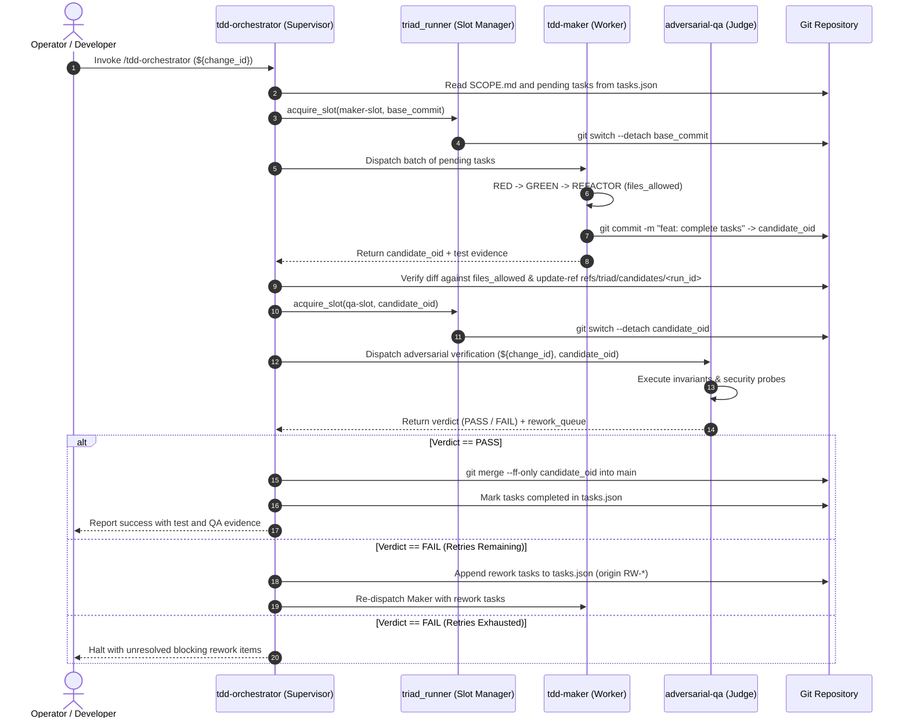
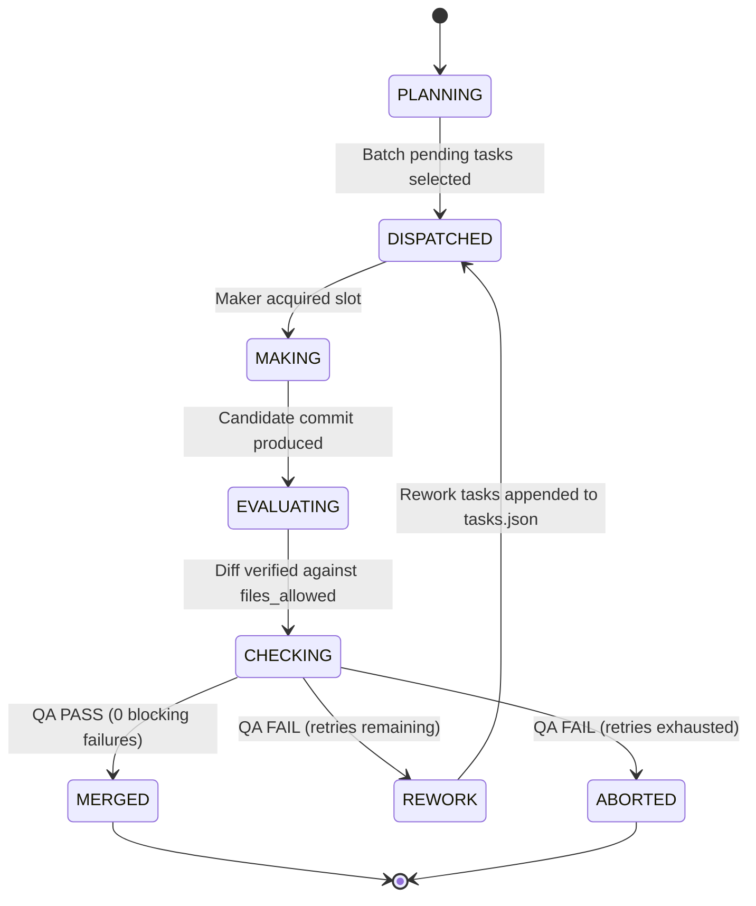

# Scope: tdd-triad-orchestrator

## 1. Intent & Boundaries

- **Objective:** Transform the monolithic `tdd-orchestrator` skill into an autonomous triad where `tdd-orchestrator` coordinates a dedicated construction worker (`tdd-maker`) and an independent verifier (`adversarial-qa`) isolated via persistent Git worktree slots.
- **In Scope:**
  - Creation of `skills/tdd-maker/SKILL.md` defining strict RED-GREEN-REFACTOR construction under `files_allowed` blast-radius constraints.
  - Refactoring of `skills/tdd-orchestrator/SKILL.md` to remove raw code editing instructions and act purely as DAG supervisor, Maker dispatcher, QA gatekeeper, and rework queue manager.
  - Implementation of a lightweight worktree manager (`scripts/triad_runner.py` and `tests/test_triad_runner.py`) using persistent detached worktree slots (`maker-slot`, `qa-slot`).
  - Handoff protocol using immutable Git commit OIDs, durable candidate refs (`refs/triad/candidates/<run_id>`), and `--ff-only` integration.
  - Documentation updates in `docs/adr/ARCHITECTURE.md` and repository indexes.
- **Out of Scope:**
  - Modifications to `skills/adversarial-qa/SKILL.md` (retains existing verified contract).
  - Multi-host distributed worker clusters or daemon-based message brokers (Redis, RabbitMQ, Kafka, Watchman).
  - Cryptographic signature verification (ed25519) on local IPC manifests.

## 2. Architectural Flow & Contracts

### Triad Execution Flow

### Triad Lifecycle State Machine

### Module and Contract Delta Table
| Component | Type | Contract / Interface | Input | Output / Return |
|---|---|---|---|---|
| `skills/tdd-maker/SKILL.md` | Skill Contract | Frontmatter + Markdown Guidelines | `tasks.json` pending tasks, `SCOPE.md`, `files_allowed` | Candidate commit OID, terminal test evidence |
| `skills/tdd-orchestrator/SKILL.md` | Skill Contract | Frontmatter + Markdown Guidelines | `${change_id}`, `tasks.json`, `qa.json` | Updated `tasks.json`, final gate report |
| `scripts/triad_runner.py` | Python CLI Script | `ensure_slots(repo_dir, slots_dir)` | Repository root, slots path | Exit 0 on ready slots |
| `scripts/triad_runner.py` | Python CLI Script | `prepare_slot(slot_name, commit_oid)` | Slot name, target commit OID | Reset slot with detached HEAD |
| `scripts/triad_runner.py` | Python CLI Script | `clean_slot(slot_name, base_oid)` | Slot name, base OID | Cleaned working tree preserving cached deps |

## 3. Behavioral Delta & Acceptance Criteria

- **A1:** Maker Skill Isolation: When `skills/tdd-maker/SKILL.md` is inspected, it strictly guides RED-GREEN-REFACTOR execution within `files_allowed`, produces an immutable Git commit, and forbids reading or modifying `qa.json` or `tasks.json`.
- **A2:** Orchestrator Supervisor Refactoring: When `skills/tdd-orchestrator/SKILL.md` is inspected, it delegates implementation to `tdd-maker`, dispatches `adversarial-qa` against the candidate commit OID, appends rework tasks to `tasks.json` upon failure up to retry budget, and retains exclusive authority over `tasks.json`.
- **A3:** Worktree Slot Manager Protocol: Given `scripts/triad_runner.py`, when executed with `ensure-slots`, `prepare-slot`, or `clean-slot`, it provisions two persistent detached worktrees (`maker-slot`, `qa-slot`), terminates lingering child processes, and restores the slot via `git reset --hard` and `git clean -fdx`.
- **A4:** Immutable Candidate Handoff & Fast-Forward Integration: Given an approved candidate commit passed by `adversarial-qa`, when `tdd-orchestrator` finishes verification, it merges the candidate into the target branch via `git merge --ff-only` and retains the candidate ref under `refs/triad/candidates/<run_id>`.

## 4. Decisions & Discrepancy Resolutions

- **D1:** Adopted `tdd-maker` as the skill name to preserve naming consistency with the repository's Maker-Checker architecture.
- **D2:** Kept `tasks.json` and `qa.json` mutations centralized in `tdd-orchestrator` to prevent concurrent write collisions between subagents.
- **D3:** Selected two persistent worktree slots (`maker-slot`, `qa-slot`) with detached HEAD rather than ephemeral worktree creation/destruction to maximize performance on Windows NTFS.
- **D4:** Discarded cryptographic signing (ed25519) and daemon message brokers as YAGNI for single-machine local agent execution.
- **S1:** Discrepancy between monolithic `tdd-orchestrator` and documented Maker-Checker pattern in `docs/adr/ARCHITECTURE.md` resolved by extracting `tdd-maker`.

## 5. Amendment Log

- 2026-10-29: Initial baseline specification approved.
