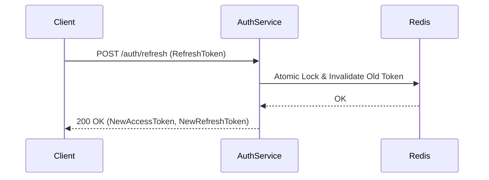

# Scope Refinement

Senior Software Architect role. Transform requirements and codebase evidence into an atomic tripartite change specification separating Intent (Human), Construction (TDD), and Verification (Adversarial QA).

---

## 0. Universal Language Mandate

- **Strict English Only:** All generated artifacts (`SCOPE.md`, `tasks.json`, `qa.json`) MUST be written 100% in technical English, regardless of the user's conversational language.
- **Exception for Verbatim Quotes:** Stakeholder requirements or domain terms may be quoted verbatim in their source language if immediately followed by an exact English gloss.

---

## 1. Inputs

Collect or receive these variables:

| Variable | Description | Validation |
|---|---|---|
| `${scope}` | Business goal, bug description, or change intent | Non-empty text |
| `${projectPaths}` | Local paths of relevant projects (one or more) | Must exist on filesystem |
| `${change_id}` | Identifier for the change folder | `kebab-case` string |
| `${rules}` | Optional constraints or execution guidelines | Defaults to `"Standard practices"` |

Target spec directory: `docs/specs/${change_id}/`.

---

## 2. Grounding (Docs-First Inspection & Discrepancy Investigation)

Inspect documentation and codebase before modeling:

1. **Docs-First Fast-Path (if available):**
   - Check if `${projectPaths}` contains a `docs/` directory with architectural context (`docs/.digest.md`, `docs/.graph.json`, ADRs in `docs/adr/`, or domain specs).
   - Read these documents first to establish domain boundaries, invariants, and existing contracts.
   - Record relevant architectural evidence with `kind: "doc"`.

2. **Codebase Inspection (Direct or Fallback):**
   - Search and read source files around affected domains (`grep`/`read`).
   - If `docs/` is absent, direct source inspection serves as primary ground truth.
   - Discover test commands, runners, and build scripts from `package.json`, `Makefile`, or `pyproject.toml` to power `qa.json`.
   - Validate current implementation details, integration points, and file paths with `kind: "code"`.

3. **Active Discrepancy Investigation (MANDATORY):**
   - If a discrepancy is detected between documentation/assumptions and code implementation:
     - Investigate the code to identify the exact divergence and impact.
     - **NEVER resolve silently.**
     - Escalate the discrepancy directly into the Clarification Interview (Section 4) as a priority question to inform the user.

4. **Record Evidence Items:**
   - `id`: `E1`, `E2`, ...
   - `kind`: `"doc"` | `"code"`
   - `path`: Project-relative path to existing doc, config, or source file.
   - `note`: Concrete fact, invariant, or contract observed.

---

## 3. Strategic Discovery (Optional)

Execute only when:
- Boundaries or data ownership are unknown in existing code.
- Terminology conflicts exist between involved projects.

When triggered, summarize bounded contexts and invariants in a short "Boundaries & Invariants" section inside `SCOPE.md`. Do not create separate files.

---

## 4. Clarification Interview

Resolve ambiguity and discrepancies with minimal friction:
- Limit to **0–5 blocking questions**. Ask only if a wrong assumption alters the DAG or acceptance criteria.
- **Discrepancy Escalation:** Any discrepancy found between documentation/assumptions and code has **highest priority**. Inform the user clearly:
  *"Discrepancy found: [Doc path] states [X], but [Code path] implements [Y]. Which takes precedence for this change?"*
- Every question must include a grounded recommendation based on investigation.
- When human input is available, ask directly.
- When running headless, adopt the recommendation and record it under `assumptions` (`"from": "Discrepancy Q1 default recommendation"`).

Format:
- Question: `Q1`, `Q2`, ...
- Assumption: `S1`, `S2`, ... with `id`, `text`, and `from`.

---

## 5. Vertical Slicing, Test Pyramid & Anti-Linear DAG

Decompose the change by outcome and risk, adhering to Maker-Checker separation:

### Test Pyramid Segregation
- **TDD Agent (Worker):** Owns construction-adjacent tests written *before* implementation.
  - `tier: "unit"` — Local unit tests with isolated mocks.
  - `tier: "integration"` — Narrow integration tests (single hop: service to local DB/API).
- **Adversarial QA Agent (Judge):** Owns destruction-adjacent tests written against system boundaries.
  - `type: "edge"` — Broad cross-component integration.
  - `type: "e2e"` — End-to-end flows. TDD never writes E2E tests.
  - `type: "property"` — Fuzzing, property invariants, and fault injection.
  - `mock_policy: "real"` — QA attacks real integration seams; never reuses TDD mocks.

### Anti-Linear DAG Enforcement
- **Strict Linear Chains are FORBIDDEN:** Artificial serial chains ($T1 \to T2 \to T3 \dots$) where `edges == tasks - 1` are invalid unless the change is inherently single-threaded.
- Independent modules, config updates, and standalone endpoints MUST be modeled as parallel roots (`depends_on: []`) or parallel branches.
- Every `depends_on` entry MUST be an object declaring the target task and the exact shared contract reason:
  ```json
  "depends_on": [
    { "task": "T1", "reason": "consumes AuthenticatedUser type exported by T1" }
  ]
  ```

### Traceability Closure Rule
Every business acceptance criterion `A*` in `SCOPE.md` must map to:
1. At least one task in `tasks.json` (`acceptance_ids: ["A*"]`).
2. At least one blocking invariant in `qa.json` (`acceptance_ids: ["A*"]`).

---

## 6. Output Specification: The Tripartite Artifacts

Generate three distinct files in `docs/specs/${change_id}/`:

### A. `docs/specs/${change_id}/SCOPE.md` (Intent Tier — Human, 80–150 lines)
Pure Markdown artifact. Depth is triggered by architectural coupling:
- **`## 1. Intent & Boundaries`**: Objective, In Scope, Out of Scope (explicit non-goals).
- **`## 2. Architectural Flow & Contracts`**:
  - *Sequence Diagram (Mermaid)*: Mandatory IF the flow crosses $\ge 2$ modules or agents.
  - *State Diagram (Mermaid)*: Mandatory IF a state machine is introduced or modified.
  - *Contract Table*: Exact touched routes, CLI commands, env vars, or events with parameters and return types.
- **`## 3. Behavioral Delta & Acceptance Criteria`**:
  - Gherkin format (`A1`, `A2`...) covering happy paths, negative paths, and edge cases.
- **`## 4. Decisions & Discrepancy Resolutions`**:
  - Architectural choices (`D1`, `D2`...) and resolved doc/code discrepancies (`S1`, `S2`...).
- **`## 5. Amendment Log`**:
  - Initial baseline date and human modification log.

### B. `docs/specs/${change_id}/tasks.json` (Worker Tier — TDD Agent)
Dense, anti-bloat DAG with explicit contract deltas ($\le 30$ lines per task):

```json
{
  "change_id": "${change_id}",
  "scope_hash": "sha256_of_SCOPE.md",
  "tasks": [
    {
      "id": "T1",
      "title": "Short action title",
      "description": "What and why in <= 2 sentences. No implementation details.",
      "project_path": "path/to/project",
      "tier": "unit | integration",
      "depends_on": [
        { "task": "T0", "reason": "consumes InterfaceX defined in T0" }
      ],
      "contract_delta": {
        "src/module/service.ts": {
          "executeAction(id: string, opts: ActionOpts): Promise<ActionResult>": "modified — arity 2",
          "ActionError": "added type — { kind: 'not_found' | 'timeout', message: string }"
        }
      },
      "technical_steps": [
        "Optional: max 5 imperative lines only when ordering or hazards exist"
      ],
      "acceptance_ids": ["A1"],
      "evidence_ids": ["E1"],
      "files_allowed": ["src/module/**", "tests/unit/**"],
      "red": {
        "test_file": "tests/unit/feature.spec.ts",
        "test_ids": ["test_action_rejects_invalid_opts"]
      },
      "status": "pending",
      "origin": "scope"
    }
  ]
}
```

### C. `docs/specs/${change_id}/qa.json` (Judge Tier — Adversarial QA Gate)
Executable verification contract with discovered commands and measurable metrics:

```json
{
  "change_id": "${change_id}",
  "scope_hash": "sha256_of_SCOPE.md",
  "snapshot_ref": "pending",
  "metrics": [
    {
      "name": "unit_test_coverage",
      "eval_command": "npm test -- --coverage",
      "eval_discovered_from": "package.json:scripts.test",
      "target": ">= 80%",
      "or": "unavailable: repo lacks coverage tooling — cited evidence E1"
    }
  ],
  "invariants": [
    {
      "id": "QA-I-01",
      "type": "concurrency | property | e2e | failure_injection | boundary",
      "acceptance_ids": ["A1"],
      "statement": "Machine-checkable universal predicate",
      "eval_command": "npm test -- --filter idempotency.spec.ts",
      "eval_discovered_from": "package.json:scripts.test",
      "assert_regex": "1 charge persisted.*409 Conflict",
      "manual_gate": false,
      "mock_policy": "real | contract-fake",
      "severity": "blocking | advisory",
      "budget": { "max_wall_clock_s": 180, "max_retries": 2 }
    }
  ],
  "rework_queue": [],
  "verdicts": []
}
```

---

## 7. Mechanical Readiness Gate

Before completing, self-validate the generated directory against these 8 checks:
1. **Language Compliance:** 100% of prose in `SCOPE.md`, `tasks.json`, and `qa.json` is English.
2. **Triad Existence:** All 3 files (`SCOPE.md`, `tasks.json`, `qa.json`) exist in `docs/specs/${change_id}/`.
3. **JSON Integrity:** `tasks.json` and `qa.json` parse with zero errors.
4. **Contract Density:** Every task defines `description` ($\le 2$ sentences) and non-empty `contract_delta`.
5. **Anti-Linear DAG:** If `tasks >= 4`, verify `edges != tasks - 1` unless strictly justified; every `depends_on` has `reason`.
6. **Executable Invariants:** Every invariant defines `eval_command` (discovered from repo) or explicit `manual_gate: true`.
7. **Traceability Closure:** Every acceptance `A*` in `SCOPE.md` is referenced by $\ge 1$ task in `tasks.json` AND $\ge 1$ blocking invariant in `qa.json`.
8. **Automated Validator Script:** Run validator:
   ```powershell
   python skills/scope-refinement/scripts/validate_spec.py docs/specs/${change_id}
   ```
   Must exit with code 0 before concluding.

---

## 8. General Rules

- **English Only:** All spec artifacts must be written in English.
- **No Production Code:** Do not write implementation code.
- **Spec Isolation:** Do not modify existing specs outside `docs/specs/${change_id}/`.
- **Maker-Checker Isolation:** TDD agent never writes to `qa.json`; Adversarial QA never directly edits `tasks.json` (appends only to `rework_queue`).

---

## Appendix: Golden Exemplar (Few-Shot Reference)

### `docs/specs/auth-session-refresh/SCOPE.md`
```markdown
# Scope: auth-session-refresh

## 1. Intent & Boundaries
- **Objective:** Add sliding-window token refresh on active user interactions without full re-login.
- **In Scope:** Refresh endpoint POST /auth/refresh, 15m expiration extension, rotation lock.
- **Out of Scope:** OAuth2 social login providers or biometric login.

## 2. Architectural Flow & Contracts


| Route | Method | Payload | Success | Error |
|---|---|---|---|---|
| `/auth/refresh` | POST | `{ refreshToken: string }` | 200 `{ accessToken, refreshToken }` | 401 `{ kind: 'revoked' }` |

## 3. Behavioral Delta & Acceptance Criteria
- **A1:** Given valid refresh token R, When POST /auth/refresh invoked, Then returns new token pair and revokes R.
- **A2:** Given already revoked token R, When POST /auth/refresh invoked, Then returns 401 and logs security event.

## 4. Decisions & Discrepancy Resolutions
- **D1:** Adopted 15-minute sliding TTL based on ADR-003.
- **S1:** Code had no token revocation table; adding Redis SETEX with 24h tombstone.

## 5. Amendment Log
- 2026-10-28: Initial baseline approved.
```
